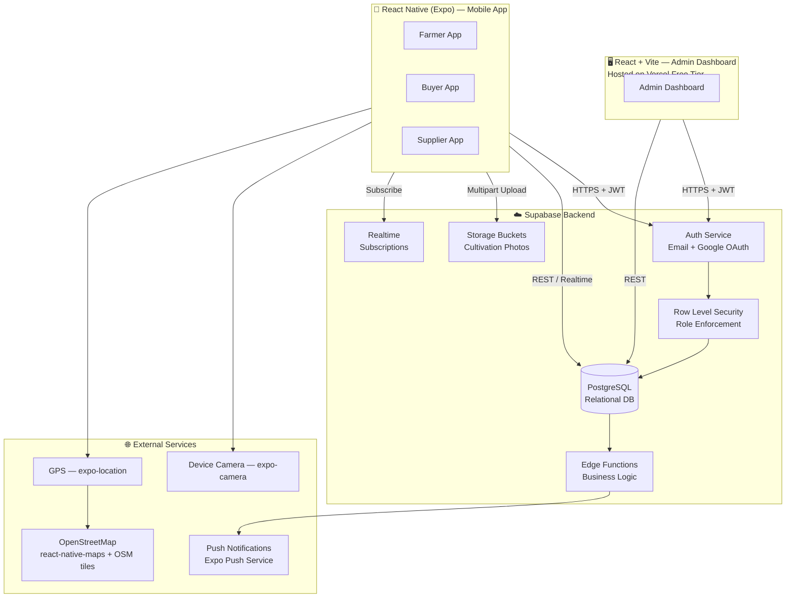
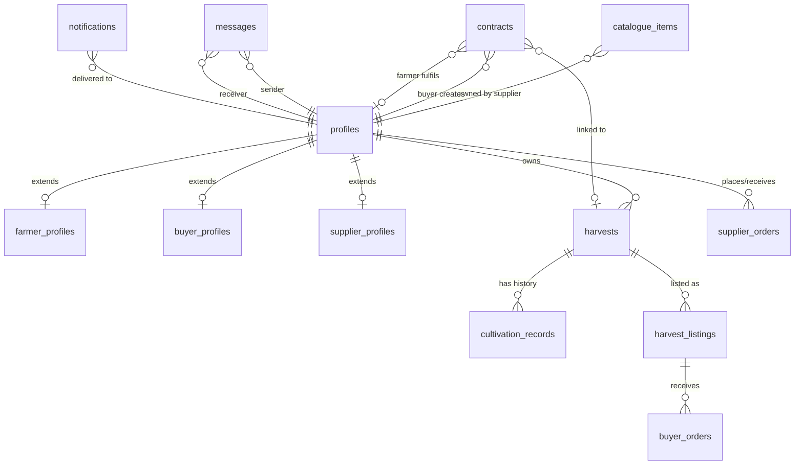
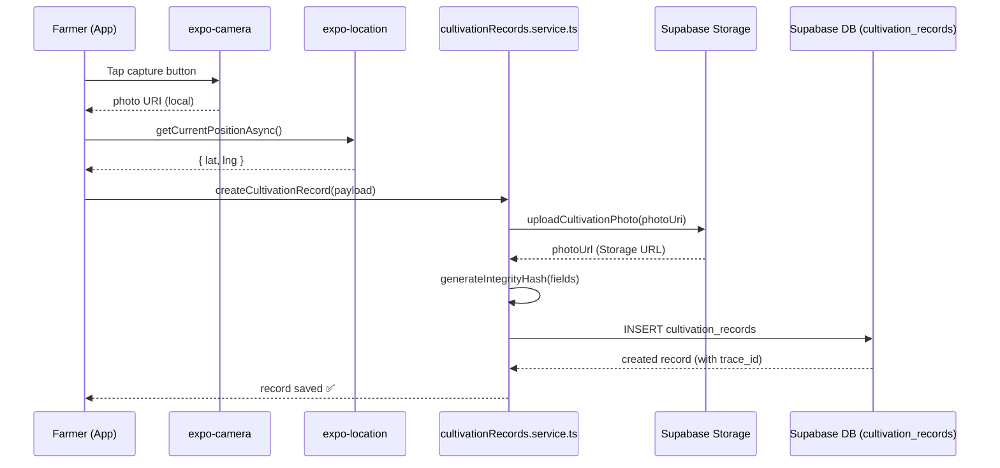
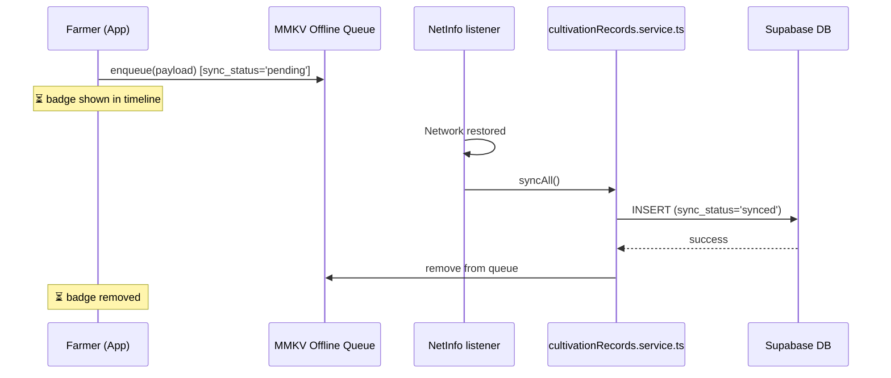
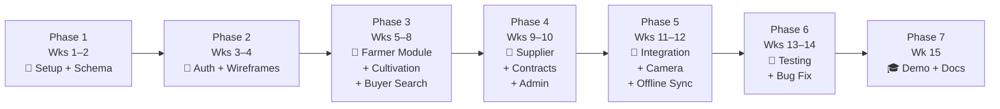

# TraceRoot — Full-Stack Architecture Plan (Final)
## React Native (Expo) + Supabase

> **Project:** Farm-to-Buyer Agricultural Contact and Transparency System
> **Group 06 · SE5104 · 2022/2023 Batch**
> **Document status:** ✅ FINAL — all decisions confirmed

---

## Confirmed Decisions

| Question | Decision |
|---|---|
| Google OAuth | ✅ Credentials available |
| Maps provider | ✅ **OpenStreetMap** (fully free, no billing required) |
| Admin hosting | ✅ **Vercel free tier** |
| Offline badge | ✅ **Show ⏳ Pending Sync** badge in cultivation timeline |
| Scope | ✅ **Planning document only** (no code scaffolding at this stage) |

---

## 1. Backend Decision: Supabase ✅

| Feature | **Supabase** ✅ | Neon |
|---|---|---|
| Auth (Email + Google OAuth) | ✅ Built-in | ❌ Needs Clerk/Stytch |
| File / Image Storage | ✅ Built-in | ❌ Needs S3/R2 |
| Realtime Subscriptions | ✅ Built-in | ❌ Needs Pusher/Ably |
| Row Level Security (RLS) | ✅ First-class | ⚠️ Manual |
| PostgreSQL | ✅ | ✅ |
| React Native SDK | ✅ `@supabase/supabase-js` | ⚠️ DB-only |
| Free Tier | ✅ Generous | ✅ Scale-to-zero |

**Verdict:** Supabase is the right choice. Your app requires Auth (email + Google), Storage (cultivation photos), and Realtime (contract/messaging notifications) — all available in one SDK, with Row Level Security natively enforcing your 4-role permission model.

---

## 2. High-Level Architecture



---

## 3. Technology Stack

| Layer | Technology | Notes |
|---|---|---|
| **Mobile Framework** | Expo SDK 51 (React Native) | Managed workflow; Camera + GPS plugins built-in |
| **Language** | TypeScript 5.x | Type safety across frontend and Supabase-generated types |
| **Navigation** | Expo Router v3 (file-based) | Role-scoped layouts, deep linking, type-safe routes |
| **State Management** | Zustand 4.x | Lightweight; minimal boilerplate |
| **Server State / Cache** | TanStack Query (React Query) 5.x | Caching, optimistic updates, offline-aware |
| **Forms** | React Hook Form + Zod | Structured cultivation forms with schema validation |
| **UI Styling** | NativeWind 4 (Tailwind for RN) | Matches Figma green/cream palette via utility classes |
| **Camera** | `expo-camera` | Live capture only — gallery access blocked |
| **Location / Geocoding** | `expo-location` | GPS tagging; reverse geocoding for location name |
| **Maps** | `react-native-maps` + OpenStreetMap tiles | Fully free; no billing account required |
| **Offline Storage** | `react-native-mmkv` | Fast key-value store for offline record queue |
| **Backend** | Supabase (Postgres + Auth + Storage + Realtime) | Single SDK for all backend concerns |
| **Admin Dashboard** | React + Vite + Supabase JS | Deployed to Vercel free tier |
| **Notifications** | Expo Push Notification Service | Free; wraps FCM/APNs |
| **Hashing / Integrity** | `expo-crypto` (SHA-256) | Per-record tamper-detection hash |
| **Secure Token Storage** | `expo-secure-store` | Auth JWT stored in device keychain |
| **Network Detection** | `@react-native-community/netinfo` | Triggers offline queue sync on reconnect |
| **Animations** | `react-native-reanimated` | Stage timeline progress bar, transitions |

---

## 4. Supabase Database Schema (PostgreSQL)

### 4.1 Entity Relationship Overview



### 4.2 Full Table Definitions

```sql
-- ─────────────────────────────────────────────────────────────────
-- SEQUENCE for human-readable trace IDs (TR-0001, TR-0002 ...)
-- ─────────────────────────────────────────────────────────────────
CREATE SEQUENCE trace_id_seq START 1;

-- ─────────────────────────────────────────────────────────────────
-- PROFILES  (extends Supabase auth.users)
-- ─────────────────────────────────────────────────────────────────
CREATE TABLE profiles (
  id           UUID PRIMARY KEY REFERENCES auth.users(id) ON DELETE CASCADE,
  role         TEXT NOT NULL CHECK (role IN ('farmer','buyer','supplier','admin')),
  full_name    TEXT NOT NULL,
  phone        TEXT,
  email        TEXT NOT NULL,
  avatar_url   TEXT,
  is_verified  BOOLEAN DEFAULT FALSE,
  created_at   TIMESTAMPTZ DEFAULT NOW()
);

-- ─────────────────────────────────────────────────────────────────
-- FARMER PROFILES
-- ─────────────────────────────────────────────────────────────────
CREATE TABLE farmer_profiles (
  id            UUID PRIMARY KEY REFERENCES profiles(id) ON DELETE CASCADE,
  farming_type  TEXT NOT NULL CHECK (farming_type IN ('greenhouse','open_field')),
  farm_name     TEXT,
  farm_location TEXT,
  farm_lat      DECIMAL(10,8),
  farm_lng      DECIMAL(11,8),
  nic_number    TEXT,
  description   TEXT
);

-- ─────────────────────────────────────────────────────────────────
-- SUPPLIER PROFILES
-- ─────────────────────────────────────────────────────────────────
CREATE TABLE supplier_profiles (
  id           UUID PRIMARY KEY REFERENCES profiles(id) ON DELETE CASCADE,
  company_name TEXT NOT NULL,
  address      TEXT,
  br_number    TEXT,
  description  TEXT
);

-- ─────────────────────────────────────────────────────────────────
-- BUYER PROFILES
-- ─────────────────────────────────────────────────────────────────
CREATE TABLE buyer_profiles (
  id            UUID PRIMARY KEY REFERENCES profiles(id) ON DELETE CASCADE,
  buyer_type    TEXT NOT NULL CHECK (buyer_type IN ('supermarket','retailer','restaurant')),
  company_name  TEXT NOT NULL,
  address       TEXT,
  br_number     TEXT
);

-- ─────────────────────────────────────────────────────────────────
-- HARVESTS  (one row = one crop cycle)
-- ─────────────────────────────────────────────────────────────────
CREATE TABLE harvests (
  id                    UUID PRIMARY KEY DEFAULT gen_random_uuid(),
  farmer_id             UUID NOT NULL REFERENCES profiles(id),
  crop_name             TEXT NOT NULL,
  crop_emoji            TEXT,                     -- e.g. '🍅'
  farming_type          TEXT NOT NULL CHECK (farming_type IN ('greenhouse','open_field')),
  planted_date          DATE NOT NULL,
  expected_harvest_date DATE,
  status                TEXT NOT NULL DEFAULT 'active'
                        CHECK (status IN ('active','harvested','sold','contracted')),
  current_stage         TEXT NOT NULL DEFAULT 'seedling'
                        CHECK (current_stage IN (
                          'seedling','vegetative_growth','flowering','fruiting','harvested'
                        )),
  description           TEXT,
  cover_image_url       TEXT,
  is_listed             BOOLEAN DEFAULT FALSE,    -- TRUE = visible in buyer marketplace
  created_at            TIMESTAMPTZ DEFAULT NOW()
);

-- ─────────────────────────────────────────────────────────────────
-- CULTIVATION RECORDS  (APPEND-ONLY — no UPDATE/DELETE in RLS)
-- ─────────────────────────────────────────────────────────────────
CREATE TABLE cultivation_records (
  id              UUID PRIMARY KEY DEFAULT gen_random_uuid(),

  -- Human-readable trace reference shown in UI (e.g. TR-0047)
  trace_id        TEXT UNIQUE NOT NULL
                  DEFAULT ('TR-' || LPAD(nextval('trace_id_seq')::TEXT, 4, '0')),

  harvest_id      UUID NOT NULL REFERENCES harvests(id),
  farmer_id       UUID NOT NULL REFERENCES profiles(id),

  -- Classification
  stage           TEXT NOT NULL CHECK (stage IN (
                    'seedling','vegetative_growth','flowering','fruiting','harvested'
                  )),
  activity_type   TEXT NOT NULL,  -- 'Growth Observation', 'Fertilizer Applied', etc.

  -- Structured form data (no free-text blobs)
  notes           TEXT,
  inputs_used     JSONB,          -- [{"name":"NPK Fertilizer","qty":"2 kg"}, ...]
  conditions      JSONB,          -- {"temperature":"28°C","humidity":"65%"}

  -- Photo evidence — LIVE CAPTURE ONLY
  photo_url       TEXT,           -- Supabase Storage URL (set after upload)
  photo_taken_at  TIMESTAMPTZ,    -- Device clock at capture moment
  is_live_capture BOOLEAN DEFAULT TRUE,   -- Always TRUE; gallery blocked at UI layer

  -- Auto-tagged location
  location_name   TEXT,           -- Reverse-geocoded: "Kandy Farm, Peradeniya"
  latitude        DECIMAL(10,8),
  longitude       DECIMAL(11,8),

  -- Offline sync support
  sync_status     TEXT NOT NULL DEFAULT 'synced'
                  CHECK (sync_status IN ('synced','pending')),

  -- Immutability / correction chain
  recorded_at     TIMESTAMPTZ NOT NULL DEFAULT NOW(),
  is_correction   BOOLEAN DEFAULT FALSE,
  corrects_id     UUID REFERENCES cultivation_records(id),

  -- Tamper-detection hash
  integrity_hash  TEXT NOT NULL
);
-- No UPDATE or DELETE RLS policy is ever created on this table.

-- ─────────────────────────────────────────────────────────────────
-- SUPPLIER CATALOGUE
-- ─────────────────────────────────────────────────────────────────
CREATE TABLE catalogue_items (
  id           UUID PRIMARY KEY DEFAULT gen_random_uuid(),
  supplier_id  UUID NOT NULL REFERENCES profiles(id),
  name         TEXT NOT NULL,
  category     TEXT NOT NULL CHECK (category IN ('seed','fertilizer','pesticide','tool','other')),
  description  TEXT,
  price        DECIMAL(10,2) NOT NULL,
  unit         TEXT NOT NULL,           -- 'kg', 'L', 'packet'
  stock_qty    INTEGER DEFAULT 0,
  image_url    TEXT,
  is_available BOOLEAN DEFAULT TRUE,
  created_at   TIMESTAMPTZ DEFAULT NOW()
);

-- ─────────────────────────────────────────────────────────────────
-- SUPPLIER ORDERS  (Farmer purchases from Supplier)
-- ─────────────────────────────────────────────────────────────────
CREATE TABLE supplier_orders (
  id           UUID PRIMARY KEY DEFAULT gen_random_uuid(),
  farmer_id    UUID NOT NULL REFERENCES profiles(id),
  supplier_id  UUID NOT NULL REFERENCES profiles(id),
  items        JSONB NOT NULL,           -- [{"item_id":"...","qty":5,"price":450.00}]
  total_amount DECIMAL(10,2) NOT NULL,
  status       TEXT NOT NULL DEFAULT 'pending'
               CHECK (status IN ('pending','confirmed','shipped','delivered','cancelled')),
  notes        TEXT,
  created_at   TIMESTAMPTZ DEFAULT NOW()
);

-- ─────────────────────────────────────────────────────────────────
-- HARVEST LISTINGS  (Farmer lists produce in marketplace)
-- ─────────────────────────────────────────────────────────────────
CREATE TABLE harvest_listings (
  id              UUID PRIMARY KEY DEFAULT gen_random_uuid(),
  harvest_id      UUID NOT NULL REFERENCES harvests(id),
  farmer_id       UUID NOT NULL REFERENCES profiles(id),
  title           TEXT NOT NULL,
  description     TEXT,
  price_per_unit  DECIMAL(10,2),
  unit            TEXT,
  available_qty   DECIMAL(10,2),
  images          JSONB,                -- array of Storage URLs
  is_active       BOOLEAN DEFAULT TRUE,
  created_at      TIMESTAMPTZ DEFAULT NOW()
);

-- ─────────────────────────────────────────────────────────────────
-- BUYER ORDERS  (Buyer purchases from Farmer listing)
-- ─────────────────────────────────────────────────────────────────
CREATE TABLE buyer_orders (
  id          UUID PRIMARY KEY DEFAULT gen_random_uuid(),
  listing_id  UUID NOT NULL REFERENCES harvest_listings(id),
  buyer_id    UUID NOT NULL REFERENCES profiles(id),
  farmer_id   UUID NOT NULL REFERENCES profiles(id),
  quantity    DECIMAL(10,2) NOT NULL,
  total_price DECIMAL(10,2),
  status      TEXT NOT NULL DEFAULT 'pending'
              CHECK (status IN ('pending','accepted','rejected','completed','cancelled')),
  notes       TEXT,
  created_at  TIMESTAMPTZ DEFAULT NOW()
);

-- ─────────────────────────────────────────────────────────────────
-- CONTRACT FARMING
-- ─────────────────────────────────────────────────────────────────
CREATE TABLE contracts (
  id              UUID PRIMARY KEY DEFAULT gen_random_uuid(),
  buyer_id        UUID NOT NULL REFERENCES profiles(id),
  farmer_id       UUID REFERENCES profiles(id),       -- NULL until matched
  crop_required   TEXT NOT NULL,
  farming_type    TEXT NOT NULL CHECK (farming_type IN ('greenhouse','open_field','any')),
  quantity        DECIMAL(10,2) NOT NULL,
  unit            TEXT NOT NULL,
  delivery_date   DATE,
  price_agreed    DECIMAL(10,2),
  requirements    TEXT,
  status          TEXT NOT NULL DEFAULT 'open'
                  CHECK (status IN (
                    'open','matched','in_progress','completed','disputed','cancelled'
                  )),
  harvest_id      UUID REFERENCES harvests(id),       -- linked once in-progress
  created_at      TIMESTAMPTZ DEFAULT NOW(),
  updated_at      TIMESTAMPTZ DEFAULT NOW()
);

-- ─────────────────────────────────────────────────────────────────
-- MESSAGES / NOTES
-- ─────────────────────────────────────────────────────────────────
CREATE TABLE messages (
  id          UUID PRIMARY KEY DEFAULT gen_random_uuid(),
  sender_id   UUID NOT NULL REFERENCES profiles(id),
  receiver_id UUID NOT NULL REFERENCES profiles(id),
  content     TEXT NOT NULL,
  is_read     BOOLEAN DEFAULT FALSE,
  created_at  TIMESTAMPTZ DEFAULT NOW()
);

-- ─────────────────────────────────────────────────────────────────
-- NOTIFICATIONS
-- ─────────────────────────────────────────────────────────────────
CREATE TABLE notifications (
  id         UUID PRIMARY KEY DEFAULT gen_random_uuid(),
  user_id    UUID NOT NULL REFERENCES profiles(id),
  title      TEXT NOT NULL,
  body       TEXT NOT NULL,
  type       TEXT NOT NULL CHECK (type IN ('order','contract','message','verification','sync')),
  ref_id     UUID,
  is_read    BOOLEAN DEFAULT FALSE,
  created_at TIMESTAMPTZ DEFAULT NOW()
);
```

### 4.3 Row Level Security (RLS) Policies

```sql
-- ── PROFILES ────────────────────────────────────────────────────
ALTER TABLE profiles ENABLE ROW LEVEL SECURITY;

CREATE POLICY "User sees own profile"
  ON profiles FOR SELECT USING (auth.uid() = id);

CREATE POLICY "User updates own profile"
  ON profiles FOR UPDATE USING (auth.uid() = id);

CREATE POLICY "Admin sees all profiles"
  ON profiles FOR SELECT USING (
    EXISTS (SELECT 1 FROM profiles WHERE id = auth.uid() AND role = 'admin')
  );

-- ── CULTIVATION RECORDS (APPEND-ONLY) ───────────────────────────
ALTER TABLE cultivation_records ENABLE ROW LEVEL SECURITY;

CREATE POLICY "Farmer inserts own records"
  ON cultivation_records FOR INSERT
  WITH CHECK (auth.uid() = farmer_id);

CREATE POLICY "Farmer reads own records"
  ON cultivation_records FOR SELECT
  USING (auth.uid() = farmer_id);

CREATE POLICY "Buyer reads records of listed harvests"
  ON cultivation_records FOR SELECT
  USING (
    EXISTS (
      SELECT 1 FROM harvests h
      WHERE h.id = harvest_id AND h.is_listed = TRUE
    )
  );

CREATE POLICY "Supplier reads records of supplied farmers"
  ON cultivation_records FOR SELECT
  USING (
    EXISTS (
      SELECT 1 FROM supplier_orders so
      WHERE so.farmer_id = cultivation_records.farmer_id
        AND so.supplier_id = auth.uid()
    )
  );

-- NO UPDATE POLICY → records are immutable
-- NO DELETE POLICY → records are permanent

-- ── HARVESTS ────────────────────────────────────────────────────
ALTER TABLE harvests ENABLE ROW LEVEL SECURITY;

CREATE POLICY "Farmer manages own harvests"
  ON harvests FOR ALL USING (auth.uid() = farmer_id);

CREATE POLICY "Buyer reads listed harvests"
  ON harvests FOR SELECT USING (is_listed = TRUE);

CREATE POLICY "Supplier reads harvests of supplied farmers"
  ON harvests FOR SELECT USING (
    EXISTS (
      SELECT 1 FROM supplier_orders so
      WHERE so.farmer_id = harvests.farmer_id
        AND so.supplier_id = auth.uid()
    )
  );

-- ── CONTRACTS ───────────────────────────────────────────────────
ALTER TABLE contracts ENABLE ROW LEVEL SECURITY;

CREATE POLICY "Buyer manages own contracts"
  ON contracts FOR ALL USING (auth.uid() = buyer_id);

CREATE POLICY "Farmer reads/updates matched contracts"
  ON contracts FOR SELECT USING (auth.uid() = farmer_id);

CREATE POLICY "Farmer accepts contract"
  ON contracts FOR UPDATE USING (auth.uid() = farmer_id);

-- ── MESSAGES ────────────────────────────────────────────────────
ALTER TABLE messages ENABLE ROW LEVEL SECURITY;

CREATE POLICY "Parties read their own messages"
  ON messages FOR SELECT
  USING (auth.uid() = sender_id OR auth.uid() = receiver_id);

CREATE POLICY "Authenticated user sends message"
  ON messages FOR INSERT
  WITH CHECK (auth.uid() = sender_id);
```

### 4.4 Storage Bucket Layout

```
supabase/storage/
│
├── cultivation-photos/          ← PRIVATE (RLS: farmer owner + authorized buyers/suppliers)
│   └── {farmer_id}/
│       └── {harvest_id}/
│           └── {record_id}.jpg
│
├── harvest-images/              ← PUBLIC (visible in buyer marketplace)
│   └── {farmer_id}/
│       └── {harvest_id}/
│           └── {filename}.jpg
│
├── catalogue-images/            ← PUBLIC (supplier product photos)
│   └── {supplier_id}/
│       └── {item_id}.jpg
│
└── avatars/                     ← PUBLIC
    └── {user_id}.jpg
```

---

## 5. React Native Project Structure (Expo Router v3)

```
TraceRoot/
│
├── app/                                  # Expo Router — file-based routes
│   ├── _layout.tsx                       # Root layout: auth guard → role redirect
│   ├── index.tsx                         # Splash screen / redirect
│   │
│   ├── (auth)/                           # Unauthenticated screens
│   │   ├── _layout.tsx
│   │   ├── login.tsx                     # ← Figma Screen 1
│   │   │                                 #   4-role icon selector + email/password
│   │   │                                 #   + Sign in with Google
│   │   ├── register.tsx                  # Role selection step
│   │   ├── register-farmer.tsx           # Farming type, farm details
│   │   ├── register-buyer.tsx            # Buyer type, company details
│   │   ├── register-supplier.tsx         # Company, BR number
│   │   └── forgot-password.tsx
│   │
│   ├── (farmer)/                         # Farmer role — bottom tab layout
│   │   ├── _layout.tsx                   # Tab: Home | Harvests | Suppliers | Messages | Profile
│   │   ├── index.tsx                     # Farmer dashboard
│   │   │
│   │   ├── harvests/
│   │   │   ├── index.tsx                 # My harvests list
│   │   │   ├── new.tsx                   # Create new harvest/crop cycle
│   │   │   ├── [id].tsx                  # ← Figma Screen 2
│   │   │   │                             #   Crop header (Stats row: Records/Photos/Days)
│   │   │   │                             #   Stage progress dots bar
│   │   │   │                             #   Accordion per stage (Seedling/Veg/Flowering…)
│   │   │   │                             #   Each record row: TR-XXXX + ⏳ if pending
│   │   │   └── [id]/
│   │   │       ├── record/
│   │   │       │   ├── new.tsx           # Add cultivation record
│   │   │       │   │                     #   Stage dropdown → Activity type dropdown
│   │   │       │   │                     #   Inputs used (dynamic list)
│   │   │       │   │                     #   CameraCapture (live only)
│   │   │       │   │                     #   GPS auto-tagged (shown to user)
│   │   │       │   │                     #   Submit → enqueue if offline
│   │   │       │   └── [recordId].tsx    # ← Figma Screen 3
│   │   │       │                         #   Crop / Stage / Activity / Date / Time / Location
│   │   │       │                         #   INPUTS USED chips
│   │   │       │                         #   PHOTO EVIDENCE — LIVE CAPTURE badge
│   │   │       │                         #   IntegrityBadge (shield icon + hash snippet)
│   │   │       └── listing.tsx           # Create/edit marketplace listing for this harvest
│   │   │
│   │   ├── contracts/
│   │   │   ├── index.tsx                 # Contracts offered to me (open/matched)
│   │   │   └── [id].tsx                 # Contract detail + accept + link harvest
│   │   │
│   │   ├── suppliers/
│   │   │   ├── index.tsx                 # Browse supplier catalogue
│   │   │   ├── [supplierId].tsx          # Supplier profile + catalogue items
│   │   │   └── orders/
│   │   │       ├── index.tsx             # My purchase orders
│   │   │       └── [id].tsx
│   │   │
│   │   ├── messages/
│   │   │   ├── index.tsx                 # Inbox (buyers who messaged me)
│   │   │   └── [userId].tsx              # Chat thread
│   │   │
│   │   └── profile/
│   │       └── index.tsx
│   │
│   ├── (buyer)/                          # Buyer role — bottom tab layout
│   │   ├── _layout.tsx                   # Tab: Home | Explore | Orders | Contracts | Profile
│   │   ├── index.tsx                     # Buyer dashboard
│   │   │
│   │   ├── explore/
│   │   │   ├── index.tsx                 # Search + filter (greenhouse / open-field)
│   │   │   └── farmer/
│   │   │       ├── [id].tsx              # Farmer public profile + active listings
│   │   │       └── [id]/
│   │   │           └── harvest/
│   │   │               └── [harvestId].tsx   # Full cultivation history (read-only)
│   │   │
│   │   ├── orders/
│   │   │   ├── index.tsx
│   │   │   └── [id].tsx
│   │   │
│   │   ├── contracts/
│   │   │   ├── index.tsx                 # My contract requests
│   │   │   ├── new.tsx                   # New contract request form
│   │   │   └── [id].tsx                  # Contract detail + status tracker
│   │   │
│   │   ├── messages/
│   │   │   ├── index.tsx
│   │   │   └── [userId].tsx
│   │   │
│   │   └── profile/
│   │       └── index.tsx
│   │
│   ├── (supplier)/                       # Supplier role — bottom tab layout
│   │   ├── _layout.tsx                   # Tab: Home | Catalogue | Orders | Farmers | Profile
│   │   ├── index.tsx                     # Supplier dashboard
│   │   │
│   │   ├── catalogue/
│   │   │   ├── index.tsx                 # My product listings
│   │   │   ├── new.tsx                   # Add product
│   │   │   └── [id].tsx                  # Edit product
│   │   │
│   │   ├── orders/
│   │   │   ├── index.tsx                 # Orders placed by farmers
│   │   │   └── [id].tsx
│   │   │
│   │   ├── buyback/
│   │   │   ├── index.tsx                 # Harvest buy-back management
│   │   │   └── [id].tsx
│   │   │
│   │   ├── farmers/
│   │   │   ├── index.tsx                 # Farmers I have supplied
│   │   │   └── [id]/
│   │   │       └── history.tsx           # View that farmer's cultivation history
│   │   │
│   │   └── profile/
│   │       └── index.tsx
│   │
│   └── (admin)/
│       └── index.tsx                     # Redirects browser to Vercel admin dashboard URL
│
├── src/
│   │
│   ├── components/
│   │   │
│   │   ├── common/                       # Shared across all roles
│   │   │   ├── AppButton.tsx             # Primary / secondary / ghost variants
│   │   │   ├── AppInput.tsx              # Labelled text input with validation state
│   │   │   ├── AppCard.tsx               # Rounded card container
│   │   │   ├── AppBadge.tsx              # Status / label chip
│   │   │   ├── AppModal.tsx              # Bottom-sheet style modal
│   │   │   ├── LoadingSpinner.tsx
│   │   │   ├── EmptyState.tsx            # Illustration + message when list is empty
│   │   │   ├── RoleIcon.tsx              # Farmer / Buyer / Supplier / Admin icon blocks
│   │   │   └── Avatar.tsx
│   │   │
│   │   ├── auth/
│   │   │   ├── RoleSelector.tsx          # 4-icon role picker (Figma Screen 1 top row)
│   │   │   └── GoogleSignInButton.tsx    # Uses expo-auth-session + Supabase OAuth
│   │   │
│   │   ├── harvest/
│   │   │   ├── HarvestCard.tsx           # Card in "my harvests" list
│   │   │   ├── HarvestStats.tsx          # Records | With Photo | Days Grown row
│   │   │   ├── GrowthStageTimeline.tsx   # Stage progress dots + accordion list
│   │   │   ├── StageProgressBar.tsx      # Horizontal dots: completed/current/future
│   │   │   ├── StageItem.tsx             # Accordion row for one stage
│   │   │   └── CultivationRecordRow.tsx  # TR-XXXX row + photo badge + ⏳ pending badge
│   │   │
│   │   ├── cultivation/
│   │   │   ├── RecordDetailCard.tsx      # Crop/Stage/Activity/Date/Time/Location grid
│   │   │   ├── InputsUsedChips.tsx       # "NPK Fertilizer — 2 kg" pill chips
│   │   │   ├── PhotoEvidence.tsx         # LIVE CAPTURE badge + full-width photo
│   │   │   ├── IntegrityBadge.tsx        # Shield icon + hash snippet (verified state)
│   │   │   ├── PendingSyncBadge.tsx      # ⏳ Pending Sync overlay for offline records
│   │   │   └── CameraCapture.tsx         # In-app live camera — no gallery access
│   │   │
│   │   ├── marketplace/
│   │   │   ├── FarmerCard.tsx            # Farmer card in buyer explore list
│   │   │   ├── HarvestListingCard.tsx    # Harvest listing with price + available qty
│   │   │   ├── CatalogueItemCard.tsx     # Supplier product card
│   │   │   └── FilterBar.tsx             # Greenhouse / Open-field toggle filter
│   │   │
│   │   ├── contract/
│   │   │   ├── ContractCard.tsx
│   │   │   ├── ContractStatusBadge.tsx   # open / matched / in_progress / completed
│   │   │   └── ContractProgressTracker.tsx  # Step-by-step tracker linked to cultivation stages
│   │   │
│   │   ├── map/
│   │   │   └── FarmLocationMap.tsx       # react-native-maps + OpenStreetMap tiles
│   │   │                                 # Shows farm pin; no Google Maps SDK needed
│   │   │
│   │   └── messaging/
│   │       ├── MessageBubble.tsx
│   │       └── NoteComposer.tsx          # Buyer "add note to farmer" input
│   │
│   ├── hooks/
│   │   ├── useAuth.ts                    # Session, user, role from Supabase
│   │   ├── useHarvests.ts                # CRUD for harvests table
│   │   ├── useCultivationRecords.ts      # Read history; create via service
│   │   ├── useContracts.ts
│   │   ├── useMessages.ts                # Realtime subscription for chat
│   │   ├── useSupplierCatalogue.ts
│   │   ├── useOrders.ts
│   │   ├── useLocation.ts                # expo-location wrapper with permission request
│   │   ├── useCamera.ts                  # expo-camera wrapper, returns URI
│   │   ├── useReverseGeocode.ts          # coords → "City, Region" via Nominatim (OSM, free)
│   │   ├── useImageUpload.ts             # Supabase Storage multipart upload
│   │   ├── useOfflineQueue.ts            # MMKV queue + NetInfo sync trigger
│   │   └── useNotifications.ts           # Expo push token registration + listener
│   │
│   ├── lib/
│   │   ├── supabase.ts                   # Supabase client (SecureStore adapter)
│   │   ├── supabase-types.ts             # Auto-generated: npx supabase gen types typescript
│   │   ├── integrity.ts                  # SHA-256 hash via expo-crypto
│   │   ├── queryClient.ts                # TanStack Query client config
│   │   ├── mmkv.ts                       # MMKV singleton instance
│   │   └── theme.ts                      # Design tokens (colors, typography, spacing)
│   │
│   ├── services/                         # Supabase interaction layer
│   │   ├── auth.service.ts               # signIn, signUp, signOut, Google OAuth
│   │   ├── profiles.service.ts           # getProfile, updateProfile, verifyUser (admin)
│   │   ├── harvests.service.ts           # createHarvest, updateStage, listPublic
│   │   ├── cultivationRecords.service.ts # createRecord (INSERT-only) + getHistory
│   │   ├── catalogue.service.ts          # CRUD for catalogue_items
│   │   ├── orders.service.ts             # createSupplierOrder, createBuyerOrder, updateStatus
│   │   ├── contracts.service.ts          # createContract, matchFarmer, updateStatus
│   │   ├── messages.service.ts           # sendMessage, getThread, markRead
│   │   ├── storage.service.ts            # uploadPhoto, getSignedUrl, deleteFile
│   │   └── notifications.service.ts      # registerToken, markRead, getAll
│   │
│   ├── store/                            # Zustand global state slices
│   │   ├── authStore.ts                  # { user, session, role, setSession }
│   │   ├── offlineQueueStore.ts          # { queue, enqueue, dequeue, pendingCount }
│   │   └── uiStore.ts                    # { toast, loading, modals }
│   │
│   ├── types/
│   │   ├── auth.types.ts
│   │   ├── harvest.types.ts
│   │   ├── record.types.ts
│   │   ├── contract.types.ts
│   │   ├── catalogue.types.ts
│   │   └── message.types.ts
│   │
│   └── utils/
│       ├── dateFormat.ts                 # formatDate("17 Sep 2026"), formatTime("09:20 AM")
│       ├── traceId.ts                    # formatTraceId(n) → "TR-0047"
│       ├── stageHelpers.ts               # stageIndex(), stageColor(), stageIcon()
│       └── validators.ts                 # Zod schemas for every form
│
├── supabase/
│   ├── config.toml                       # Local dev config
│   ├── migrations/
│   │   ├── 001_initial_schema.sql        # All tables from Section 4.2
│   │   ├── 002_rls_policies.sql          # All RLS from Section 4.3
│   │   ├── 003_storage_buckets.sql       # Bucket creation + policies
│   │   └── 004_seed_data.sql             # Demo farmer/buyer/supplier for testing
│   └── functions/
│       ├── send-notification/
│       │   └── index.ts                  # Deno: insert notification + Expo push call
│       ├── verify-live-capture/
│       │   └── index.ts                  # Deno: validate is_live_capture before record accepted
│       └── sync-offline-records/
│           └── index.ts                  # Deno: batch upsert from offline queue payload
│
├── admin-dashboard/                      # Separate Vite + React web app → Vercel
│   ├── src/
│   │   ├── pages/
│   │   │   ├── Dashboard.tsx             # Summary metrics (users, records, contracts)
│   │   │   ├── Users.tsx                 # All users table: verify / reject / suspend
│   │   │   ├── Farmers.tsx               # Farmer list + link to cultivation history
│   │   │   ├── Contracts.tsx             # All contracts + status management
│   │   │   └── Reports.tsx               # Exportable CSV activity reports
│   │   ├── components/
│   │   │   ├── UserRow.tsx
│   │   │   ├── VerifyButton.tsx
│   │   │   └── DataTable.tsx
│   │   └── lib/
│   │       └── supabase.ts               # Uses service_role key (admin-only, never in mobile)
│   ├── vercel.json                       # SPA rewrite rule for React Router
│   ├── package.json
│   └── vite.config.ts
│
├── assets/
│   ├── images/
│   │   ├── splash.png
│   │   ├── icon.png
│   │   └── adaptive-icon.png
│   └── fonts/
│       └── Inter/                        # Inter Regular, SemiBold, Bold
│
├── app.json                              # Expo app config (bundleId, permissions)
├── babel.config.js
├── tailwind.config.js                    # NativeWind + custom TraceRoot colors
├── tsconfig.json
├── .env                                  # EXPO_PUBLIC_SUPABASE_URL + ANON_KEY
├── .env.local                            # SUPABASE_SERVICE_ROLE_KEY (admin only)
└── package.json
```

---

## 6. Key Implementation Reference

### 6.1 Supabase Client (Mobile — SecureStore adapter)

```typescript
// src/lib/supabase.ts
import { createClient } from '@supabase/supabase-js';
import * as SecureStore from 'expo-secure-store';
import { Database } from './supabase-types';

const ExpoSecureStoreAdapter = {
  getItem:    (key: string) => SecureStore.getItemAsync(key),
  setItem:    (key: string, value: string) => SecureStore.setItemAsync(key, value),
  removeItem: (key: string) => SecureStore.deleteItemAsync(key),
};

export const supabase = createClient<Database>(
  process.env.EXPO_PUBLIC_SUPABASE_URL!,
  process.env.EXPO_PUBLIC_SUPABASE_ANON_KEY!,
  {
    auth: {
      storage: ExpoSecureStoreAdapter,
      autoRefreshToken: true,
      persistSession: true,
      detectSessionInUrl: false,   // required for React Native
    },
  }
);
```

### 6.2 Cultivation Record Service (Append-Only + Integrity Hash)

```typescript
// src/services/cultivationRecords.service.ts
import { supabase } from '@/lib/supabase';
import { generateIntegrityHash } from '@/lib/integrity';
import { uploadCultivationPhoto } from './storage.service';

export interface CreateRecordPayload {
  harvestId:    string;
  stage:        string;
  activityType: string;
  notes?:       string;
  inputsUsed?:  Array<{ name: string; qty: string }>;
  conditions?:  Record<string, string>;
  photoUri:     string;          // local file URI from expo-camera ONLY
  latitude:     number;
  longitude:    number;
  locationName: string;
  isCorrection?: boolean;
  correctsId?:   string;
  syncStatus?:   'synced' | 'pending';
}

export async function createCultivationRecord(payload: CreateRecordPayload) {
  const { data: { user } } = await supabase.auth.getUser();
  if (!user) throw new Error('Not authenticated');

  // 1. Upload photo to Supabase Storage
  const photoUrl = await uploadCultivationPhoto(payload.photoUri, user.id, payload.harvestId);

  // 2. SHA-256 tamper-detection hash
  const integrityHash = await generateIntegrityHash({
    harvestId:    payload.harvestId,
    farmerId:     user.id,
    stage:        payload.stage,
    activityType: payload.activityType,
    photoUrl,
    latitude:     payload.latitude,
    longitude:    payload.longitude,
    recordedAt:   new Date().toISOString(),
  });

  // 3. INSERT — no UPDATE/DELETE ever issued here
  const { data, error } = await supabase
    .from('cultivation_records')
    .insert({
      harvest_id:     payload.harvestId,
      farmer_id:      user.id,
      stage:          payload.stage,
      activity_type:  payload.activityType,
      notes:          payload.notes,
      inputs_used:    payload.inputsUsed,
      conditions:     payload.conditions,
      photo_url:      photoUrl,
      photo_taken_at: new Date().toISOString(),
      is_live_capture: true,
      latitude:       payload.latitude,
      longitude:      payload.longitude,
      location_name:  payload.locationName,
      sync_status:    payload.syncStatus ?? 'synced',
      is_correction:  payload.isCorrection ?? false,
      corrects_id:    payload.correctsId ?? null,
      integrity_hash: integrityHash,
    })
    .select()
    .single();

  if (error) throw error;
  return data;
}

// READ-ONLY — buyers and suppliers call this
export async function getCultivationHistory(harvestId: string) {
  const { data, error } = await supabase
    .from('cultivation_records')
    .select('*')
    .eq('harvest_id', harvestId)
    .order('recorded_at', { ascending: true });

  if (error) throw error;
  return data;
}
```

### 6.3 Integrity Hash (SHA-256 via expo-crypto)

```typescript
// src/lib/integrity.ts
import * as Crypto from 'expo-crypto';

interface HashInput {
  harvestId: string; farmerId: string; stage: string;
  activityType: string; photoUrl: string;
  latitude: number; longitude: number; recordedAt: string;
}

export async function generateIntegrityHash(input: HashInput): Promise<string> {
  // Sort keys for deterministic serialization
  const payload = JSON.stringify(input, Object.keys(input).sort());
  return await Crypto.digestStringAsync(
    Crypto.CryptoDigestAlgorithm.SHA256,
    payload
  );
}
```

### 6.4 Live Camera (Gallery Intentionally Blocked)

```typescript
// src/components/cultivation/CameraCapture.tsx
import { CameraView, useCameraPermissions } from 'expo-camera';
import * as Location from 'expo-location';

interface Props {
  onCapture: (uri: string, location: { lat: number; lng: number; name: string }) => void;
}

export function CameraCapture({ onCapture }: Props) {
  const [permission, requestPermission] = useCameraPermissions();
  const cameraRef = useRef<CameraView>(null);

  const takePicture = async () => {
    if (!cameraRef.current) return;

    // Live capture — no ImagePicker call anywhere in this component
    const photo = await cameraRef.current.takePictureAsync({ quality: 0.8 });

    const loc = await Location.getCurrentPositionAsync({
      accuracy: Location.Accuracy.High,
    });
    const [address] = await Location.reverseGeocodeAsync({
      latitude: loc.coords.latitude,
      longitude: loc.coords.longitude,
    });

    onCapture(photo.uri, {
      lat:  loc.coords.latitude,
      lng:  loc.coords.longitude,
      name: `${address.city}, ${address.region}`,
    });
  };

  if (!permission?.granted) {
    return (
      <View>
        <Text>Camera permission required for live capture</Text>
        <Button onPress={requestPermission} title="Grant Permission" />
      </View>
    );
  }

  return (
    <CameraView ref={cameraRef} style={{ flex: 1 }} facing="back">
      {/* LIVE CAPTURE badge — matches Figma Screen 3 */}
      <View style={styles.liveBadge}>
        <View style={styles.greenDot} />
        <Text style={styles.liveText}>LIVE CAPTURE</Text>
      </View>
      <TouchableOpacity onPress={takePicture} style={styles.captureBtn} />
    </CameraView>
  );
}
```

### 6.5 OpenStreetMap via react-native-maps (Fully Free)

```typescript
// src/components/map/FarmLocationMap.tsx
import MapView, { Marker, UrlTile } from 'react-native-maps';

interface Props {
  latitude: number;
  longitude: number;
  locationName: string;
}

export function FarmLocationMap({ latitude, longitude, locationName }: Props) {
  return (
    <MapView
      style={{ height: 200, borderRadius: 12 }}
      initialRegion={{
        latitude, longitude,
        latitudeDelta: 0.01, longitudeDelta: 0.01,
      }}
      mapType="none"              // disable Google/Apple base tiles
    >
      {/* OpenStreetMap tile layer — 100% free, no API key */}
      <UrlTile
        urlTemplate="https://tile.openstreetmap.org/{z}/{x}/{y}.png"
        maximumZ={19}
        flipY={false}
      />
      <Marker coordinate={{ latitude, longitude }} title={locationName} />
    </MapView>
  );
}
```

### 6.6 OpenStreetMap Reverse Geocoding (Nominatim — Free)

```typescript
// src/hooks/useReverseGeocode.ts
// Nominatim is OSM's free geocoding API — no key required, fair-use rate limits apply.

export async function reverseGeocode(lat: number, lng: number): Promise<string> {
  const res = await fetch(
    `https://nominatim.openstreetmap.org/reverse?format=json&lat=${lat}&lon=${lng}`,
    { headers: { 'User-Agent': 'TraceRoot/1.0 (your@email.com)' } }  // required by Nominatim ToS
  );
  const data = await res.json();
  const { city, town, village, state } = data.address ?? {};
  return `${city ?? town ?? village ?? ''}, ${state ?? ''}`.trim();
}
```

### 6.7 Offline Queue with ⏳ Pending Sync Badge

```typescript
// src/hooks/useOfflineQueue.ts
import { MMKV } from 'react-native-mmkv';
import NetInfo from '@react-native-community/netinfo';
import { createCultivationRecord, CreateRecordPayload } from '@/services/cultivationRecords.service';

const storage = new MMKV();

interface QueuedRecord {
  id:        string;
  payload:   CreateRecordPayload;
  queuedAt:  string;
}

function getQueue(): QueuedRecord[] {
  const raw = storage.getString('offline_queue');
  return raw ? JSON.parse(raw) : [];
}
function saveQueue(q: QueuedRecord[]) {
  storage.set('offline_queue', JSON.stringify(q));
}

export function useOfflineQueue() {
  const [queue, setQueue] = useState<QueuedRecord[]>(getQueue());

  const enqueue = (payload: CreateRecordPayload) => {
    // Mark record with pending sync status
    const item: QueuedRecord = {
      id:       Math.random().toString(36).slice(2),
      payload:  { ...payload, syncStatus: 'pending' },
      queuedAt: new Date().toISOString(),
    };
    const updated = [...queue, item];
    saveQueue(updated);
    setQueue(updated);
  };

  const syncAll = async () => {
    const net = await NetInfo.fetch();
    if (!net.isConnected || queue.length === 0) return;

    const remaining: QueuedRecord[] = [];
    for (const item of queue) {
      try {
        await createCultivationRecord({ ...item.payload, syncStatus: 'synced' });
      } catch {
        remaining.push(item);   // retry next time
      }
    }
    saveQueue(remaining);
    setQueue(remaining);
  };

  // Auto-sync on reconnect
  useEffect(() => {
    const unsub = NetInfo.addEventListener(state => {
      if (state.isConnected) syncAll();
    });
    return unsub;
  }, [queue]);

  return { queue, enqueue, syncAll, pendingCount: queue.length };
}

// Usage in CultivationRecordRow.tsx:
// {record.sync_status === 'pending' && <PendingSyncBadge />}
```

### 6.8 Pending Sync Badge Component

```typescript
// src/components/cultivation/PendingSyncBadge.tsx
export function PendingSyncBadge() {
  return (
    <View style={styles.badge}>
      <Text style={styles.icon}>⏳</Text>
      <Text style={styles.label}>Pending Sync</Text>
    </View>
  );
}

const styles = StyleSheet.create({
  badge: {
    flexDirection: 'row',
    alignItems: 'center',
    backgroundColor: '#FFF3CD',
    borderRadius: 8,
    paddingHorizontal: 8,
    paddingVertical: 3,
    gap: 4,
  },
  icon:  { fontSize: 12 },
  label: { fontSize: 11, color: '#856404', fontFamily: 'Inter-SemiBold' },
});
```

### 6.9 Role-Based Navigation

```typescript
// app/_layout.tsx
import { useAuth } from '@/hooks/useAuth';

const ROLE_ROUTES: Record<string, string> = {
  farmer:   '/(farmer)',
  buyer:    '/(buyer)',
  supplier: '/(supplier)',
  admin:    '/(admin)',
};

export default function RootLayout() {
  const { session, role, loading } = useAuth();

  if (loading) return <SplashScreen />;
  if (!session) return <Redirect href="/(auth)/login" />;

  return <Redirect href={ROLE_ROUTES[role] ?? '/(auth)/login'} />;
}
```

### 6.10 Google OAuth (Supabase + expo-auth-session)

```typescript
// src/services/auth.service.ts
import * as WebBrowser from 'expo-web-browser';
import * as AuthSession from 'expo-auth-session';
import { supabase } from '@/lib/supabase';

WebBrowser.maybeCompleteAuthSession();

export async function signInWithGoogle() {
  const redirectUrl = AuthSession.makeRedirectUri({ scheme: 'traceroot' });

  const { data, error } = await supabase.auth.signInWithOAuth({
    provider: 'google',
    options: {
      redirectTo: redirectUrl,
      skipBrowserRedirect: true,
    },
  });

  if (error || !data.url) throw error;

  const result = await WebBrowser.openAuthSessionAsync(data.url, redirectUrl);

  if (result.type === 'success' && result.url) {
    const { params } = AuthSession.parseRedirectResult(result.url);
    await supabase.auth.setSession({
      access_token:  params.access_token,
      refresh_token: params.refresh_token,
    });
  }
}
```

### 6.11 Growth Stage Timeline (Figma Screen 2)

```typescript
// src/components/harvest/GrowthStageTimeline.tsx
const STAGES = [
  { key: 'seedling',          label: 'Seedling',          icon: '🌱', color: '#74C69D' },
  { key: 'vegetative_growth', label: 'Vegetative Growth', icon: '🌿', color: '#74C69D' },
  { key: 'flowering',         label: 'Flowering',         icon: '🌸', color: '#E76F51' },
  { key: 'fruiting',          label: 'Fruiting',          icon: '🍅', color: '#74C69D' },
  { key: 'harvested',         label: 'Harvested',         icon: '📦', color: '#74C69D' },
] as const;

const stageKeys = STAGES.map(s => s.key);

export function GrowthStageTimeline({ harvest, records, pendingQueue }) {
  const [expanded, setExpanded] = useState<string | null>(harvest.current_stage);

  const byStage = STAGES.reduce((acc, s) => ({
    ...acc,
    [s.key]: records.filter(r => r.stage === s.key),
  }), {} as Record<string, typeof records>);

  // Merge offline-queued records (pending) into the relevant stage
  const pendingByStage = pendingQueue.reduce((acc, item) => {
    const stage = item.payload.stage;
    return { ...acc, [stage]: [...(acc[stage] ?? []), { ...item, sync_status: 'pending' }] };
  }, {} as Record<string, any[]>);

  return (
    <ScrollView>
      <StageProgressBar currentStage={harvest.current_stage} stages={STAGES} />

      {STAGES.map(stage => {
        const synced  = byStage[stage.key] ?? [];
        const pending = pendingByStage[stage.key] ?? [];
        const allRecords = [...synced, ...pending];
        const isCompleted = stageKeys.indexOf(stage.key) < stageKeys.indexOf(harvest.current_stage);
        const isCurrent   = stage.key === harvest.current_stage;

        return (
          <StageItem
            key={stage.key}
            stage={stage}
            records={allRecords}
            pendingCount={pending.length}       // drives ⏳ badge on stage header
            isCompleted={isCompleted}
            isCurrent={isCurrent}
            isExpanded={expanded === stage.key}
            onToggle={() => setExpanded(p => p === stage.key ? null : stage.key)}
          />
        );
      })}
    </ScrollView>
  );
}
```

---

## 7. Design System Tokens (Matching Figma)

```typescript
// src/lib/theme.ts
export const colors = {
  primary:      '#2D6A4F',   // Deep forest green — buttons, verified stage dots
  primaryLight: '#74C69D',   // Light green — completed stage icons, chips
  accent:       '#E76F51',   // Warm orange — current stage icon, NOW badge
  background:   '#F8F5F0',   // Warm cream — main screen background
  surface:      '#FFFFFF',   // Cards, modals
  border:       '#E8E0D5',   // Subtle dividers
  text: {
    primary:    '#1B1B1B',
    secondary:  '#6B6B6B',
    muted:      '#AAAAAA',
    inverse:    '#FFFFFF',
  },
  status: {
    verified: '#2D6A4F',
    pending:  '#856404',
    pendingBg:'#FFF3CD',     // ⏳ pending sync badge background
    danger:   '#E63946',
    info:     '#4361EE',
  },
};

export const typography = {
  heading1:   { fontFamily: 'Inter-Bold',     fontSize: 28, lineHeight: 34 },
  heading2:   { fontFamily: 'Inter-Bold',     fontSize: 22, lineHeight: 28 },
  subheading: { fontFamily: 'Inter-SemiBold', fontSize: 16, lineHeight: 22 },
  body:       { fontFamily: 'Inter-Regular',  fontSize: 14, lineHeight: 20 },
  caption:    { fontFamily: 'Inter-Regular',  fontSize: 12, lineHeight: 16 },
  label:      { fontFamily: 'Inter-SemiBold', fontSize: 12, lineHeight: 16 },
};

export const spacing = {
  xs: 4, sm: 8, md: 16, lg: 24, xl: 32, '2xl': 48,
};

export const radius = {
  sm: 8, md: 12, lg: 16, full: 9999,
};
```

---

## 8. NPM Package Manifest

```json
{
  "name": "traceroot",
  "version": "1.0.0",
  "dependencies": {
    "expo":                              "^51.0.0",
    "expo-router":                       "^3.5.0",
    "expo-camera":                       "^15.0.0",
    "expo-location":                     "^17.0.0",
    "expo-crypto":                       "^13.0.0",
    "expo-secure-store":                 "^13.0.0",
    "expo-notifications":                "^0.28.0",
    "expo-web-browser":                  "^13.0.0",
    "expo-auth-session":                 "^5.5.0",
    "expo-image":                        "^1.12.0",
    "@supabase/supabase-js":             "^2.43.0",
    "@tanstack/react-query":             "^5.0.0",
    "react-hook-form":                   "^7.51.0",
    "zod":                               "^3.22.0",
    "zustand":                           "^4.5.0",
    "nativewind":                        "^4.0.0",
    "react-native-mmkv":                 "^2.12.0",
    "react-native-maps":                 "^1.14.0",
    "@react-native-community/netinfo":   "^11.3.0",
    "date-fns":                          "^3.6.0",
    "react-native-reanimated":           "^3.10.0",
    "react-native-gesture-handler":      "^2.16.0",
    "react-native-safe-area-context":    "^4.9.0",
    "react-native-screens":              "^3.31.0"
  },
  "devDependencies": {
    "typescript":                        "^5.3.0",
    "supabase":                          "^1.166.0",
    "tailwindcss":                       "^3.4.0"
  }
}
```

---

## 9. Admin Dashboard — Vercel Deployment

```
admin-dashboard/
├── vercel.json                    # Ensures SPA routing works on refresh
└── src/
    └── lib/
        └── supabase.ts            # service_role key — admin full access (bypasses RLS)
```

```json
// admin-dashboard/vercel.json
{
  "rewrites": [{ "source": "/(.*)", "destination": "/index.html" }]
}
```

> [!CAUTION]
> The **service_role** Supabase key used in the admin dashboard bypasses all Row Level Security. It must **never** be committed to the public repository or included in the mobile app bundle. Store it only in Vercel's environment variable settings.

**Deployment steps:**
1. `npm create vite@latest admin-dashboard -- --template react-ts`
2. Push `admin-dashboard/` to GitHub
3. Connect to Vercel → set `VITE_SUPABASE_URL` + `VITE_SUPABASE_SERVICE_ROLE_KEY` in Vercel env vars
4. Deploy

---

## 10. Security & Data Integrity Summary

| Mechanism | How It Works |
|---|---|
| **Append-only records** | No RLS `UPDATE` or `DELETE` policy exists on `cultivation_records` — records are physically immutable |
| **SHA-256 integrity hash** | Computed from sorted JSON of (harvestId, farmerId, stage, activityType, photoUrl, GPS, timestamp); stored alongside every record |
| **Live capture enforced** | `CameraCapture.tsx` uses `expo-camera` exclusively; `ImagePicker` is never imported in cultivation flows |
| **GPS auto-tag** | `expo-location` fires on every capture; reverse-geocoded via Nominatim (OSM) to human-readable address |
| **Correction chain** | Wrong data? Farmer submits a new record with `is_correction=true` + `corrects_id`; original remains visible |
| **Role enforcement** | RLS policies on every table; each role can only see and do what is explicitly permitted |
| **JWT auth** | Supabase short-lived JWTs; `expo-secure-store` (device keychain) persists tokens safely |
| **HTTPS everywhere** | All Supabase traffic is TLS; Nominatim requests are HTTPS |
| **Admin isolation** | `service_role` key lives only in Vercel env vars; the mobile `anon` key cannot bypass RLS |
| **⏳ Pending sync badge** | Offline-queued records are visually flagged in the cultivation timeline until confirmed synced |

---

## 11. Data Flow Diagrams

### Cultivation Record Submission (Online)



### Cultivation Record Submission (Offline → Sync)



---

## 12. Development Phases & Sprint Plan



| Sprint | Deliverables | Owner(s) |
|---|---|---|
| **1** | Supabase project, all migrations (schema + RLS + storage), `supabase gen types` | All |
| **2** | Auth: login screen, 4-role selector, all 3 registration forms, Google OAuth | 22CSE0397 |
| **3** | Farmer dashboard, harvest CRUD, stage timeline UI (Figma Screen 2) | 22CSE0377 |
| **4** | Live camera + GPS capture + Supabase Storage upload (Figma Screen 3) | 22CSE0377 |
| **5** | Buyer explore/search/filter + cultivation history viewer | 22CSE0365 |
| **6** | Supplier catalogue management + farmer↔supplier order flow | 22CSE0365 |
| **7** | Contract farming module (create, match, track, link to harvest) | 22CSE0384 |
| **8** | Admin web dashboard → Vercel deploy | 22CSE0397 |
| **9** | Offline queue (⏳ badge) + Realtime notifications + messaging | All |
| **10** | Unit tests, integration tests, usability testing, bug fixes, demo prep | All |

---

## 13. Module-to-File Ownership

| Member | Module | Primary Files |
|---|---|---|
| **22CSE0377** | Farmer + Cultivation History | `app/(farmer)/harvests/`, `src/components/harvest/`, `src/components/cultivation/`, `src/services/cultivationRecords.service.ts`, `src/hooks/useCamera.ts`, `src/hooks/useOfflineQueue.ts` |
| **22CSE0365** | Buyer + Supplier | `app/(buyer)/explore/`, `app/(supplier)/`, `src/components/marketplace/`, `src/services/orders.service.ts`, `src/components/messaging/`, `src/hooks/useMessages.ts` |
| **22CSE0384** | Contract Farming + Farmer | `app/(buyer)/contracts/`, `app/(farmer)/contracts/`, `src/components/contract/`, `src/services/contracts.service.ts` |
| **22CSE0397** | Admin + Buyer UI | `admin-dashboard/`, `app/(buyer)/`, `src/services/notifications.service.ts`, `supabase/functions/send-notification/`, `app/(auth)/` |

---

## 14. Environment Variables Reference

```bash
# .env  (committed — safe public values for mobile)
EXPO_PUBLIC_SUPABASE_URL=https://your-project.supabase.co
EXPO_PUBLIC_SUPABASE_ANON_KEY=eyJhbGci...

# .env.local  (never committed — sensitive)
SUPABASE_SERVICE_ROLE_KEY=eyJhbGci...     # Only used in admin dashboard

# Vercel dashboard env vars (for admin-dashboard deployment)
VITE_SUPABASE_URL=https://your-project.supabase.co
VITE_SUPABASE_SERVICE_ROLE_KEY=eyJhbGci...
```
